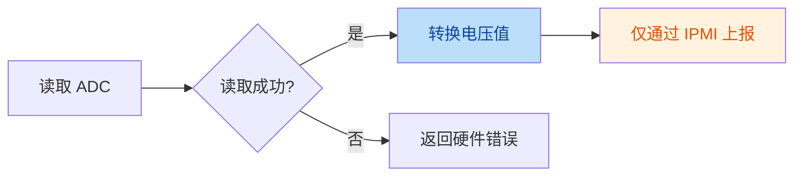
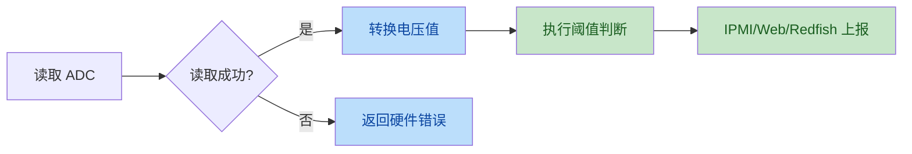

# 代码审查报告（示例）

> 本文件仅演示输出结构，文件名、行号和问题均为虚构。

## 审查概览

- 审查文件：`src/adc_sensor.c`、`src/sensor_config.c`
- 审查范围：commit `abc1234`
- 推断意图：新增 ADC 电压 Sensor，并通过北向接口上报读值和事件
- 问题统计：`[CRITICAL] x 0`、`[MAJOR] x 2`、`[MINOR] x 0`、`[NIT] x 0`
- 提交标题：`[SPX][DEMO][RR13-BMC]：新增 ADC 电压 Sensor`
- 提交类型：新功能
- Tracker：`#12345`
- 测试证据：部分提供

## 变更可视化

### 变更前方案

### 变更后方案

## Review 事项汇总

| # | 标记 | 检查项 | 状态 | 关联详细项 | 结果与证据 |
|---|---|---|---|---|---|
| 1 | V | 提交标题、Description、Tracker | 已检查-无风险 | — | 按模块提交；标题符合 `[项目名][客户][RR13-BMC]：内容`；Description 为新功能模板且包含变更描述；Tracker 为 `#12345` |
| 2 | X | 测试步骤与测试结果 | 当前项有风险 | 风险确认 #1 | 缺少 ADC 五次测量及北向接口测试结果 |
| 3 | V | 安全性 | 已检查-无风险 | — | 未引入外部输入、命令执行或权限路径 |
| 4 | V | 性能与长期运行 | 已检查-无风险 | — | 采样次数有界，未新增无限队列或线程 |
| 5 | X | 正确性与错误路径 | 当前项有风险 | 问题 #1；问题 #2 | `adc_sensor.c:118` 未检查读取失败；`sensor_config.c:203` 异常路径泄漏 |
| 6 | V | 可维护性、函数说明、命名与日志语义 | 已检查-无风险 | — | 新增函数说明和命名与实际 ADC 处理一致 |
| 7 | X | 测试覆盖 | 当前项有风险 | 风险确认 #2 | 未覆盖 ADC 读取失败和配置解析失败路径 |
| 8 | V | ByteD C 编码规范 | 已检查-无风险 | — | 类型、命名、注释和括号风格符合规范 |
| 9 | X | C 语言高风险模式 | 当前项有风险 | 问题 #1；问题 #2 | 命中返回值忽略和异常路径内存泄漏 |
| 10 | V | AMI 老代码隐患 | 已检查-无风险 | — | 未发现早返回漏清理、静态缓冲区或 fork/锁问题 |
| 11 | V | Python/Shell 脚本风险 | 已检查-不涉及 | — | 本次未修改 `.py` 或 `.sh` 文件 |
| 12 | X | 资源生命周期 | 当前项有风险 | 问题 #2 | `sensor_config.c:203` 参数校验失败时未释放 cJSON 对象 |
| 13 | V | 控制流与边界 | 已检查-无风险 | — | 数组、转换长度、循环退出及格式化字符串均有边界 |
| 14 | V | 并发与调用链影响 | 已检查-无风险 | — | 已检查 ADC 调用者及北向上报路径，未改变共享状态同步 |
| 15 | V | 全仓符号冲突 | 已检查-无风险 | — | `ADC_SAMPLE_COUNT`：已搜索源码、头文件、Makefile、Kconfig 和 `-D` 参数；1 处定义、2 处引用，无 `#undef`、宏重定义或链接冲突 |
| 16 | V | 日志转储风险 | 已检查-不涉及 | — | 本次未修改日志缓冲、队列、转储或轮转逻辑 |
| 17 | V | BMC 升级逻辑与系统内部文件变更 | 已检查-不涉及 | — | 本次未修改升级流程或系统内部文件 |
| 18 | X | 硬件/配置及北向接口影响 | 当前项有风险 | 风险确认 #3 | 涉及 ADC 硬件读值与北向上报，缺少 IPMI/Web/Redfish 测试结果 |
| 19 | X | Sensor 参数 | 当前项有风险 | 问题 #1；风险确认 #4 | `ADC_VOLT`：Disabled=产品配置关闭 ADC 通道；No Reading=设备未就绪、读取超时或原始值无效；告警值=有效读值跨越 upper/lower 阈值并按 hysteresis 恢复；优先级=`Disabled > No Reading > 告警值 > 正常值`；负值可能性=校准偏移后可能小于 0，读取 API 的 `-1` 也表示失败；类型链=`int32_t raw -> int32_t calibrated -> uint16_t cache`；负值策略=合法范围不允许负值，应在写入 cache 前转为 `No Reading`；散热策略=不涉及（非温度 Sensor）；Health LED 映射=UNC/LNC 为 Amber，UCR/UNR/LCR/LNR 为 Red，No Reading 为 Amber，多告警取最高级别；LED 恢复条件=对应事件 deassert、读值经过 hysteresis 回到正常且所有同级/更高级告警清除。当前代码未检查负值，可能转换成超大值并触发上限告警，同时缺少 number/type/mask、Health LED 映射配置及部门确认材料 |
| 20 | X | ADC Sensor 测量 | 当前项有风险 | 风险确认 #5 | 未提供 AC 场景连续五次读值，无法确认浮动不超过 3% |
| 21 | V | AC Cycle 影响 | 已检查-不涉及 | — | 本次未修改上电初始化、持久化或 AC Cycle 读值逻辑 |
| 22 | V | 北向操作审计日志 | 已检查-不涉及 | — | 本次仅新增 ADC 读值上报，未新增或修改 IPMI/Web/Redfish 状态变更动作 |
| 23 | V | IPMI 指令权限变更影响 | 已检查-不涉及 | — | 本次未修改 IPMI 指令权限表、注册权限或授权逻辑 |
| 24 | V | 部件升级/长时操作散热风险 | 已检查-不涉及 | — | 本次未新增部件升级、烧录、长时间诊断或持续占用硬件总线/线程的操作 |

## 问题总览

| # | 严重级别 | 置信度 | 问题标题 | 建议摘要 | 代码位置 |
|---|---|---|---|---|---|
| 1 | `[MAJOR]` | High | ADC 读取返回值未检查 | 失败时停止转换并返回错误 | `src/adc_sensor.c:118` |
| 2 | `[MAJOR]` | High | cJSON 异常路径内存泄漏 | 统一进入清理路径 | `src/sensor_config.c:203` |

## 确认代码问题

### 问题 #1. `[MAJOR]` ADC 数据有效性未检查

**关联汇总项**：#5、#9、#19

**问题点**：`src/adc_sensor.c:118` 的读取失败返回值未检查。校准结果可能为负数，却直接写入 `uint16_t` 缓存。

**风险/后果**：读取失败时可能上报旧值或未初始化值；负值隐式转换为超大正数后可能触发上限告警和错误 Health LED。

**修复建议**：检查读取返回值；写入无符号缓存前验证范围，将无效负值和错误读值转换为 `No Reading`。

**验证建议**：覆盖读取失败、合法负值、`-1` 错误码、零值和最小允许值，确认北向接口和 Health LED 不上报错误告警。

### 问题 #2. `[MAJOR]` cJSON 异常路径内存泄漏

**关联汇总项**：#5、#9、#12

**问题点**：`src/sensor_config.c:203` 的参数校验失败路径直接返回，未释放已经创建的 cJSON 对象。

**风险/后果**：长驻进程反复加载配置时内存持续增长，最终可能耗尽 BMC 可用内存。

**修复建议**：统一进入清理路径，保证所有返回分支调用匹配的释放 API。

**验证建议**：循环执行失败路径并监控 RSS，确认内存不持续增长。

## 待确认风险与证据缺口

### 风险确认 #1. Sensor 测试步骤与实测结果不完整

**事项类型**：证据缺口

**关联汇总项**：#2

**代码/配置位置**：commit Description、ADC Sensor 测试记录。

**待确认事项/提示依据**：新增 Sensor 的测试步骤与实际结果是否一一对应，是否覆盖 ADC 五次测量和北向接口呈现。

**风险/影响**：提交记录无法证明读值稳定性和接口行为，问题可能在集成阶段才暴露。

**需补充材料**：AC 场景连续五次读值、IPMI/Web/Redfish 结果及测试环境信息。

**关闭条件/标记限制**：补齐可复现的步骤、结果和对应证据，证明读值及接口行为符合预期；关联汇总项无其他未关闭问题或风险、且未命中专项强制提示时可改为 `V`。

### 风险确认 #2. 异常路径回归测试覆盖不足

**事项类型**：证据缺口

**关联汇总项**：#7

**代码/配置位置**：`src/adc_sensor.c:118`、`src/sensor_config.c:203`。

**待确认事项/提示依据**：读取失败和配置解析失败路径是否已加入稳定的回归测试。

**风险/影响**：后续修改可能重新引入错误值上报或资源泄漏而无法及时发现。

**需补充材料**：失败注入测试、断言结果及自动化测试日志。

**关闭条件/标记限制**：新增覆盖两条失败路径的回归测试并通过执行；关联汇总项无其他未关闭问题或风险、且未命中专项强制提示时可改为 `V`。

### 风险确认 #3. 北向接口联动测试缺失

**事项类型**：证据缺口

**关联汇总项**：#18

**代码/配置位置**：`src/adc_sensor.c` 的 IPMI/Web/Redfish 上报路径。

**待确认事项/提示依据**：三类北向接口对正常读值、`No Reading`、阈值告警和恢复的行为是否一致。

**风险/影响**：不同接口可能显示不同状态、告警级别或错误码，造成运维判断不一致。

**需补充材料**：IPMI 命令输出、Web 页面/API 响应、Redfish 响应及告警恢复测试结果。

**关闭条件/标记限制**：提供三类接口的对比测试，确认状态、读值和告警一致；关联汇总项无其他未关闭问题或风险、且未命中专项强制提示时可改为 `V`。

### 风险确认 #4. Sensor 定义与 Health LED 配置证据缺失

**事项类型**：证据缺口

**关联汇总项**：#19

**代码/配置位置**：`config/sensors/adc_volt.json`、Health LED 聚合配置。

**待确认事项/提示依据**：Sensor number/type/mask、阈值预期、Health LED 告警映射及部门确认是否完整。

**风险/影响**：Sensor 可能无法正确上报，或告警级别、Health LED 颜色和恢复条件与产品设计不一致。

**需补充材料**：EE/Power/Thermal 确认材料、Sensor 配置表、Health LED 策略及阈值/事件预期。

**关闭条件/标记限制**：配置与确认材料齐全，并验证各告警 assert/deassert 的 LED 行为符合设计；问题 #1 及该汇总项其他问题或风险也关闭、且未命中专项强制提示时，#19 才可改为 `V`。

### 风险确认 #5. ADC 稳定性测量证据缺失

**事项类型**：证据缺口

**关联汇总项**：#20

**代码/配置位置**：`ADC_VOLT` 测试记录。

**待确认事项/提示依据**：AC 场景连续五次读值浮动是否不超过 3%。

**风险/影响**：读值抖动可能导致阈值告警频繁 assert/deassert，造成错误 Health LED 状态。

**需补充材料**：五次原始值、换算值、测试条件和浮动计算结果。

**关闭条件/标记限制**：提供测量数据并确认浮动符合项目要求，或更新滤波/阈值策略后重新验证；关联汇总项无其他未关闭问题或风险、且未命中专项强制提示时可改为 `V`。