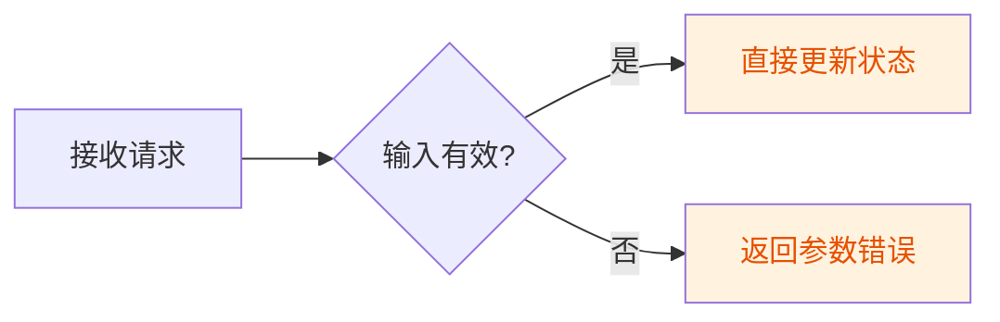
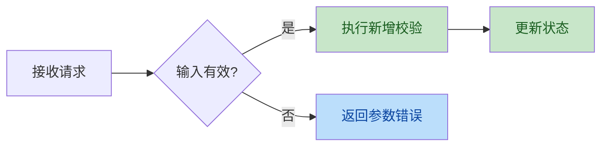

# Mermaid 变更可视化规范

## 输出要求

- 除仅修改注释或格式外，每次审查必须同时输出“变更前方案”和“变更后方案”两张 Mermaid 对照图。
- 变更前方案基于 diff 左侧或目标分支基线代码；变更后方案基于 diff 右侧或当前变更代码。
- 两张图必须使用相同的图类型、方向、参与者名称和可比较的节点名称，确保读者可以逐项对照。
- 默认输出一组前后对照图；复杂变更如需分别展示业务流程与技术流程，最多输出两组，每组都必须包含变更前和变更后。
- 优先使用 `flowchart` 或 `sequenceDiagram` 展示实际调用链、判断分支、数据流或交互顺序。
- 图中只保留与本次变更有关的关键路径，不绘制无流向的分类框图。
- 在变更前图中高亮将被删除或替换的路径，在变更后图中高亮新增或修改的路径。
- 无法取得基线代码时，不得推测原方案；应明确标记“变更前方案待提供基线代码”。
- 对全新功能，变更前图应展示原请求路径、不支持分支或功能接入前的基线流程，不能只画一个“功能不存在”的孤立节点。

## 可读性

- 节点样式必须同时指定背景色和文字色，以兼容亮色与暗色主题。
- 推荐配色：
  - 新增或修改：`fill:#c8e6c9,color:#1a5e20`
  - 未变化的对照节点：`fill:#bbdefb,color:#0d47a1`
  - 将删除、替换或存在风险：`fill:#fff3e0,color:#e65100`
  - `fill:#f3e5f5,color:#7b1fa2`
- 避免只设置 `fill` 而不设置 `color`。

## 示例

### 变更前方案

### 变更后方案

不要输出只有分类、没有关系或流向的静态框图。